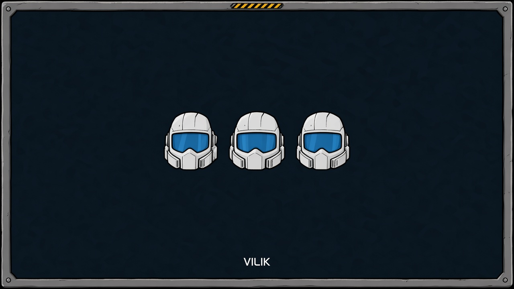

# Unlimited players



Hit the player limit? Bring your whole crew.

- Raises the multiplayer cap to 32766 joining players, the most that Steam and direct-IP hosting allow
- Only the host needs the mod, everyone else joins as usual

MelonLoader mod for Stellar Drive.

## Installation

Install it from the Stellar Mod Manager, or copy `UnlimitedPlayers.dll` from the latest release into the game's `Mods` folder. The game needs MelonLoader.

## Building from source

You need the .NET SDK (any version that can build `net472` projects) and Stellar Drive with MelonLoader installed. The project references the game's own assemblies, so nothing from the game is included in this repository.

```
dotnet build src/UnlimitedPlayers.csproj -c Release -p:GameDir="C:\Program Files (x86)\Steam\steamapps\common\StellarDrive Demo"
```

The DLL ends up in `src/bin/Release`. Add `-p:CopyToMods=true` to copy it into the game's `Mods` folder.

## How the code is organised

| File | What it does |
| --- | --- |
| `UnlimitedPlayers.cs` | Patches the Steam and direct-IP host so they accept 32766 remote players |

## License

MIT, see [LICENSE](LICENSE).
